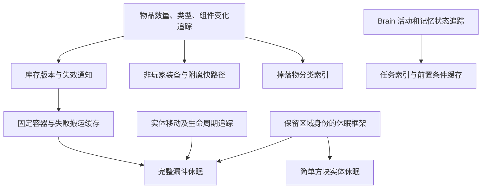

# Lithium 优化思想在 DeerFolia 中的迁移价值分析

分析日期：2026-10-15。DeerFolia 基线：`26.3.x` / `a81b44bb7c6198d6d80f9c8ea5db38ff24fa15a9`。

本文评估的是减少重复工作的机制、适用负载和实现边界。Lithium 的版本只用于固定可复查的参考源码，不作为迁移范围或实现方式的限制。新的实现应以当前 DeerFolia 的 Minecraft、Paper、Moonrise、Folia 代码为基础。

本文保存 `a81b44b` 基线的源码分析；下文的“缺口”“未修改”和源码行号均指该基线。随后完成的第一批实现、前置修复与验证记录见[首批实施报告](lithium-phase1-results.md)。文中的收益高低表示在指定负载下的潜力，不能据此给出 TPS 提升百分比；模块索引也不是可直接相加的性能覆盖率。

## 结论与评估方法

最值得借鉴的是三类机制：状态不变时跳过重复检查；没有工作时暂停 ticking 并在变化后唤醒；先用廉价索引排除不可能匹配的候选。已有的循环、数组和算术微优化可以保留并测量，但扩大这类补丁数量不等于得到完整 Lithium 的收益。

必须逐机制比较现有实现。例如 Paper 有漏斗优化，不代表已经具备库存变化通知、失败搬运缓存和漏斗休眠；Moonrise 有 POI 和碰撞重写，则应优先复用其索引和查询，而非再实现一套相同用途的基础设施。

覆盖状态的含义：

- **已有**：找到了当前基座中的对应机制；仍不意味着所有细节与 Lithium 相同。
- **部分**：存在同领域优化，但本行指出的机制仍有缺口。
- **缺口**：在已检查的相关执行路径中没有对应机制。
- **待测／待核实**：静态分析不足以判断收益或完整等价性，不计作已完成覆盖。
- **不适用**：客户端、模组加载器专属机制，或当前架构已经替换的路径。

优先级的含义：P0 是扩大优化前的正确性或测量前提；P1 是近期值得做独立原型的候选；P2 是有价值但需要基础设施或更复杂适配；P3 是只在 profile 显示热点时再做。优先级综合收益潜力、实现成本和语义风险，不是运行速度排名。

## 值得迁移的机制与优先级

### P1：近期值得原型验证的项目

| ID | 机制与当前状态 | 主要收益场景 | 成本和实现边界 |
| --- | --- | --- | --- |
| P1-1 | **空方块效果收集器快路径、延迟分配：缺口** | 大量实体在普通方块上活动，没有火／水／细雪等效果时，省掉空 flush 和集合分配 | 低至中；保留 before/effect/after 顺序、Paper 记录的触发位置和实体死亡后停止处理 |
| P1-2 | **四种高度图共用向下扫描：缺口** | 拆除高空平台、树木或最高阻挡方块，减少同一列的重复 BlockState 读取 | 中；保留四种独立谓词、Moonrise raw 数组与序列化数据同步；普通地下更新的收益可能小 |
| P1-3 | **游戏事件投递只查询已有注册表：缺口** | 大量脚步／振动事件，但多数区块段没有接收者；避免创建空监听器注册表 | 低至中；先做局部只读访问器，保留 Bukkit GenericGameEvent、改半径／取消和 Folia 检查 |
| P1-4 | **Brain 可运行任务与运行任务索引：缺口** | 村民、猪灵等任务多而实际运行任务少的生物，减少完整遍历和列表分配 | 中；按 Brain 所有、维护活动切换／启动／停止，保留任务顺序、重入与传送特殊处理 |
| P1-5 | **记忆存在性变化驱动的前置条件缓存：缺口** | 多个行为反复因同一个缺失记忆无法启动 | 中；缓存 PRESENT／ABSENT／REGISTERED 检查，包含到期与 Brain 重建，不缓存世界条件或完整任务结果 |
| P1-6 | **非 POI 搜索的区块段必要条件剪枝：具体调用点缺口** | 僵尸／僵尸猪灵等反复寻找稀少海龟蛋 | 中；先支持明确目标类型，只排除不可能匹配的段，保留原搜索顺序、加载范围和完整目标判断 |
| P1-7 | **Folia 方块实体休眠框架与少量明确状态：缺口** | 工作倒计时归零的合成器、空闲营火、完全关闭的潜影盒、冷却结束且红石锁定的漏斗 | 中；保留位置、BE 身份、区域时间和全部唤醒入口；初版保留 ticker 包装，不立即重写调度器 |
| P1-8 | **物品／库存变化追踪的基础与影子校验：缺口** | 为装备、漏斗和物品分类提供可复用的“是否变化”依据 | 高；这一阶段只验证修订号／通知是否漏报，不以启用所有消费者为目标；每项写入开销必须测量 |

P1-1 至 P1-3 的影响面较局部，适合作为第一批可独立验证的改动。P1-4 至 P1-6 可按实际生物负载选取；P1-7 和 P1-8 是两条独立基础设施路线，规模较大，应拆小验证。遗漏的矿车类型查询也可顺手复用 Moonrise class 索引，但它属于低预期收益的小补充，不应挤占主要项目。

### P2：有价值，但要先解决依赖或复杂语义

| ID | 候选机制 | 当前状态与收益目标 | 前置条件／成本 |
| --- | --- | --- | --- |
| P2-1 | **非玩家装备 dirty slots、无 TICK 附魔快路径** | 缺口；固定装备的生物每 tick 仍全槽比较并进入附魔遍历 | 高价值但依赖完整 ItemStack 追踪；保护硫磺立方体等 override、装备事件重入、数据包效果；玩家装备另评估 |
| P2-2 | **固定容器缓存、库存空满／比较器缓存、失败搬运复用** | Paper 漏斗已有局部优化，但这套变化驱动机制缺失；空源、满目标与堵塞分类器有潜力 | 需要内容／容量／列表 generation、双箱身份、方块状态／方向及监听器条件；不能把插件取消缓存为永久失败 |
| P2-3 | **漏斗实体查询结果复用与完整休眠** | 缺口；减少无可拾取物品或搬运条件未变化时的整轮工作 | 很高；接 Moonrise 位移和生命周期，必须感知同一区块段内小范围移动、物品组件变化、监听器动态注册 |
| P2-4 | **熔炉／酿造台和幽匿系列休眠** | 缺口；在空闲冶炼／酿造阵列、无振动／无扩散的幽匿设备中有价值 | 熔炉／酿造台最保守空态可随 P1 试验；完整方案需 live API setter、配方／燃料更新、候选振动和事件重试唤醒 |
| P2-5 | **活动导航监听集合** | Folia 已按区域收集 Mob，但无路径 Mob 仍参与方块更新后的导航遍历 | 中至高；维护路径开始／停止、导航切换、异步完成及区域迁移；配置关闭该类路径更新时无收益 |
| P2-6 | **状态级路径类型缓存、危险 section 标记、路径读取优化** | 有坐标缓存和 chunk 引用缓存，仍缺这些具体机制 | 高；先明确异步搜索视图，保守处理动态方块／标签变化；共享数字不等于与方块内容一致的快照 |
| P2-7 | **停用无用传感器／行为** | 傻子职业搜索、部分成年动物和山羊传感器有剩余工作 | 中；支持 Bukkit 年龄／职业反向修改、Brain 重建和插件使用记忆；不能永久删除后假设不会恢复 |
| P2-8 | **跳跃加权候选结构、袭击旗帜模板缓存** | 候选反复分配／扫描、旗帜模板反复构造仍存在 | 中；跳跃保持概率并明确随机序列差异，模板不可共享可变装备；分别适合动物场与袭击塔 |
| P2-9 | **scheduled ticks 紧凑去重与分桶队列** | 当前是对象去重＋PriorityQueue；集中流体／红石计划任务可能获益 | 高；先测无分配去重，再独立测队列；保留 priority/subTickOrder、持久化、dirty 与区域 offsetTicks |
| P2-10 | **流体多方向共享 BFS** | 已有 SpreadContext 状态／落差缓存，仍可减少独立递归搜索的重复 | 高；保留标签、方向与落差选择、Bukkit 事件及不加载新区块；缓存只在安全的单次查询内存活 |
| P2-11 | **移动活塞有限状态形状缓存** | 基础形状算法已优化，但标准位移下仍重复 move／union | 中；局部、有界且安全发布，动态形状与非标准进度回退；测活塞与实体碰撞同时密集的负载 |
| P2-12 | **红石功率计算复用邻居读取** | 默认 evaluator 仍有重复查询，不能因存在 Alternate Current 就认为已全覆盖 | 中；保留传播顺序／邻居更新／事件，分别测 VANILLA、EIGENCRAFT、ALTERNATE_CURRENT 等路径 |
| P2-13 | **通用射线单次 chunk／section 缓存及无流体快路径** | 已有不加载区块、空气跳过和 fluidstate 复用；还有局部缺口 | 中；不能绕过 capturedBlockStates、Bukkit predicate 副作用或改变缺失区块结果 |
| P2-14 | **投射物碰撞候选分组** | Moonrise 有空间／类型索引，但缺“必定不能被该类投射物击中”的类别筛除 | 高；保持反射／可重定向标签、动态 canHitEntity、穿透、龙部件和事件；未知类型回退 |
| P2-15 | **高密度掉落物按物品／组件／数量分类** | 已有合并降频和空间索引，但同一范围内仍逐个检查其他 ItemEntity | 高；密度阈值、不可变 key、顺序和事件处理，低密度继续现有扫描；不做改变结果的批量合并 |
| P2-16 | **地图墙重复维护合并** | 有更新间隔，但每个观察者的更新仍可再次扫描同图玩家 | 高；地图共享跨区域，需保留锁／快照、隐身装备、Bukkit renderer 和标记清理 |
| P2-17 | **刷怪列表 membership 补足** | Paper Builder 有 HashSet，CODEC 可能生成通用线性 contains 列表 | 先确认实际运行时实例；只补目标不可变列表，保持 equals、重复项和权重语义，不全局换容器 |

P2-1 至 P2-3 是最值得投入的系统性方向之一，但未证明每个服务器都从中获益。P2-14 至 P2-16 等更依赖特定装置规模。完整游戏事件区域稀疏索引、同区块 ticker readiness 复用也属于 P2 后续研究，应先看 P1 的局部方案后还剩多少开销。

### P3：保留为有热点证据后的候选

| 机制 | 暂不优先的原因 |
| --- | --- |
| 静止实体支撑块／窒息跨 tick 缓存 | 依赖可靠区段变化追踪；潜影盒等动态形状可能不改变 BlockState。可先单独实验一次调用内的向下碰撞短路 |
| 梯子内不可推动实体索引 | Paper 攀爬拥挤规则、Bukkit collidable／例外和 scoreboard 改变条件，不能统一排除 |
| 通用 shape context 延迟初始化 | Moonrise 碰撞热路径已有 LazyEntityCollisionContext，剩余通用调用需先证明热度 |
| BE 世界边界／支持状态缓存、ticker Map 替换 | readiness 等已有便宜实现；动态边界、无效 BE 清理与 midTickTasks 增加维护成本，support_cache 还有显式行为差异 |
| 更细 POI 类型直查、已知坐标直接占位、稀疏列位图 | 主查询已经 Moonrise 优化；必须证明差额，不能再次整体重写 |
| 猪灵驱避物全范围负查询快退 | 26.3 已用 FilteredSectionCache.maybeHas 跳过无目标 section；全范围预扫描也可能增加邻近目标场景的工作 |
| 青蛙可攻击传感器的廉价条件前置、空位查询 bitset 算法 | 前者改变视线缓存求值时机；后者在约 1e-7 的坐标边界可能选到不同落点。只作明确语义取舍后的实验，默认不按等价优化启用 |
| 末地出口门等 pattern 必需材料预筛 | 主要改善罕见尖峰，常态收益有限；未知谓词和区块加载必须回退 |
| 刷怪计数按 section 重排 | Folia 已区域化并使用紧凑数组，重排未必更便宜且会改变浮点累加顺序；26.3 环境属性不能简单按 biome 缓存 |
| 小 palette 阈值、通用计数数组化 | Moonrise 已替换主要 palette／重计数路径，只剩具体阈值和旁路差异 |
| 紧凑 sin LUT、enum Map、额外算术／集合微优化 | JIT、额外分支、代码体积和缓存命中决定净收益；sin 的数值转换与边界语义还必须重新验证 |

### 已有或不值得整套重复迁入的方向

| 范围 | 已核对的对应机制／排除理由 |
| --- | --- |
| 普通碰撞、体素形状、实体空间查询 | Moonrise 的 section/type/class 索引、硬碰撞组、单 AABB、坐标数组、形状 OR 缓存和专用合并路径；保留局部剩余候选即可 |
| 爆炸主体 | 已有方块／阻力／chunk 缓存、预计算射线、形状复用及 Folia 区域爆炸曝光缓存；跳空气还有事件与游戏行为细节，不宜整套替换 |
| POI 主查询与传送门 | 近端／距离剪枝、最近 N 个、随机选择、避免全范围预加载等已由 Moonrise 实现 |
| 区块访问、票据、palette 与序列化主体 | loaded chunk 快路、按可过期票据扫描、FastHashMapPalette、压缩／序列化快速路径已存在；实际同步锁不能当作调试锁删除 |
| 随机 tick、温度／流体属性／高度访问 | 稀疏 tickingBlocks 抽样、直接温度计算、属性预计算和直接高度返回已有实现 |
| NBT、tracker、实体 tick 集合、ticket 集合 | fastutil NBT／tracker、IteratorSafeOrderedReferenceSet 或 Folia 集合、SortedArraySet 单次 removeIf 已覆盖或替换旧热路径 |
| 现有 DeerFolia 小优化 | 已有诱惑传感器单遍选最近、GateBehavior 循环、乘客收集、方向／槽位数组、实体早退、天气／冻水、海平面缓存等；不要重复计算为新增工作 |
| Profiler 两线程缓存 | 当前 Profiler 已有未启用时的 ACTIVE_COUNT 快路径；双线程专用结构不适合 Folia |
| 客户端 tick、箱子盖子动画、NeoForge 启动／chunk_load_tricks | 专用服务端不适用；普通箱子和末影箱服务端本就没有盖子动画 ticker |
| 调试／加载器兼容层 | 不属于独立生产提速项；WorldEdit 的“直接写块也要失效缓存”思想仍应纳入新缓存设计 |

## 最值得吸收的几种设计方式

**先做状态版本，再让消费者跳过工作。** 物品的数量、类型、组件、容器容量和列表替换共同决定库存版本；Brain 的记忆存在性决定任务前置条件版本。先用影子模式比对版本判断与完整计算，再启用跳过。装备、漏斗、掉落物索引可以共享物品变化的基础能力，但各自保持独立的缓存和回退条件。

**把休眠设计成可恢复的状态机。** 方块实体睡眠后仍然存在，仍能保存、接收有关事件并参与区域迁移。初版优先省去内部 tick 工作，之后再判断是否值得从活跃迭代列表剔除。所有唤醒来源明确可列举，才能扩大到事件复杂的熔炉、酿造台和漏斗。

**优先证明“不可能”，减少候选。** 海龟蛋搜索、投射物查询和物品合并都适合先排除绝不匹配的区块段或实体组。过滤器允许多留下候选，不允许漏掉有效候选；剩余候选继续执行现有完整判断和事件逻辑。不要因为有索引就顺便改变目标选择顺序。

**合并同一次操作内的重复查询。** 高度图共用扫描、流体多方向搜索、红石邻居读取、单次射线缓存等，不需要跨 tick 保存复杂状态，通常比世界级长期缓存更容易审计。即使如此，插件回调与动态数据仍是缓存有效期的边界。

这些设计与 Minecraft 具体版本无关，但实现必须保留当前行为。例如 26.3 比较器公式与参考 Lithium 样本不同，应缓存当前输出；当前三角函数的转换也不同，应保留当前数值结果；硫磺立方体有装备变化 override，不能因缓存而绕过其状态更新。

下面是主要依赖关系；高度图、空效果收集器和局部游戏事件查询可以独立实施。

## 应先处理的现有问题与复核事项

**P0：村庄距离静态缓存的作用域与线程归属有问题。** `NMS/world/entity/ai/behavior/GoToClosestVillage.java:15` 使用静态普通 Long2ObjectOpenHashMap，`:31` 只以 section 坐标为 key，`:32` 起读写和清理。源码可以确认不同世界相同坐标共享条目、多个 region 可能访问同一非线程安全容器。应先移除这层附加缓存或重新设计为正确的世界／区域归属和失效；仅加锁仍不能修复 key 和过期语义。底层已有村庄距离传播器，也应先测它是否真的需要这一层 TTL 缓存。本次未修改该实现，也未声称已复现运行故障。

**P0（寻路类候选的前提）：审视异步输入一致性。** `PathfindingContext.java:19` 捕获区域 PathTypeCache，`PathFinder.java:88` 在 worker 中执行；cache 内是普通数组，所属区域又会 invalidate。PathNavigationRegion 保存的 ChunkAccess 引用也不是内容快照。源码显示共享可变数据风险，尚未做并发复现。新的路径类型缓存、危险区段判定和直读 section 不能建立在“异步就可以直接共享世界数据”的假设上；也不必为独立的高度图或空效果快路径等待所有寻路重构完成。

**现有 16 项移植也需要按实际收益复核。** 小方法上的配置读取可能抵消部分算术收益；AttributeInstance 未定义值相等比较，换 identity set 不能自动视为消除了昂贵 equals；乘客遍历由惰性 stream 变为提前收集、袭击 bossbar 合并的时序、GateBehavior 融合检查的假设，都应在相关场景验证。此处列的是静态审查发现的待验证假设，不把它们描述为已复现 bug。

## 建议实施顺序与停止条件

1. **建立基线并处理 P0。** 固定代表性世界，确认热点；先处理 POI 缓存作用域，给寻路类工作明确读取和缓存契约。保留当前源码与产物作为 A/B 基线。
2. **先做局部收益项目。** P1-1／P1-2／P1-3 分开实现与差分；按生物负载选择 P1-4／P1-5／P1-6。出现行为不一致就先修复，不把多个候选叠加后一起猜原因。
3. **建设两条基础能力。** 稳定身份的 BE 休眠从合成器等简单状态开始；物品变化追踪先影子验证，随后启用非玩家装备和局部库存缓存。两者分别控制，不需要一次性建立完整 Lithium 框架。
4. **扩展系统性收益。** 固定原生容器→空满／比较器→失败搬运复用→实体结果失效→完整漏斗休眠。装备和掉落物消费者按各自前提接入。每步保留未知输入回退。
5. **按真实装置选择 P2。** 活动导航、计划 tick、流体、活塞、红石、投射物或地图墙，不必全部默认开启。P3 只在测到剩余热点时投入。

如果当前实现已足够快、新方案在变化频繁时退化、维护的失效关系比节省的工作更贵，或者无法保留所需行为，则暂停该候选。接受优化的依据是当前 DeerFolia 上可重复的净改善与正确性，不是 Lithium 是否有这个包，也不是移植行数。

## 详细源码核对与模块索引

| 详细报告 | 内容 |
| --- | --- |
| [AI、寻路与 POI](lithium-analysis/ai.md) | 17 组机制、DAB／异步寻路叠加、前置风险、源码行号和验证 |
| [库存、漏斗与方块实体](lithium-analysis/inventory-ticking.md) | 休眠分类、库存修订号、Bukkit 写入来源、Folia 生命周期和验证矩阵 |
| [实体、装备、碰撞与射线](lithium-analysis/entities-collisions.md) | 装备／附魔、物品合并、投射物、地图墙与 Moonrise 重叠 |
| [世界、区块与调度](lithium-analysis/world-chunks.md) | 高度图、游戏事件、scheduled ticks、流体、palette／ticket 覆盖 |
| [微优化与现有移植复核](lithium-analysis/micro-existing.md) | 集合／数学／活塞／红石、JIT 影响、现有 16 项假设复核 |
| [完整配置模块索引（CSV）](lithium-module-inventory.csv) | 172 个参考配置条目与机制判断的对应关系；包含父分组和依赖，不能据此算覆盖率 |

明细中的局部优先级与总体排期有冲突时，以本文为准：装备变化追踪属于高价值方向，但完整实施排在物品变化基础之后；少量最保守熔炉／酿造台空态可做 P1 原型，广泛休眠属于 P2。

## Folia 下的共同设计要求

### 数据归属比换线程安全容器更重要

实体的 Brain、装备状态和局部缓存尽量附着在实体上；方块实体休眠状态附着在方块实体上；空间索引附着在区块段或区域数据上。需要跨 tick 存活的区域数据应使用 Folia 的区域生命周期，处理拆分、合并、卸载和迁移。

不要把某个工作线程永久当作某个区域。`ThreadLocal` 可以作为无引用逃逸、支持重入的临时工作缓冲区，但不适合作为区域长期状态的所有者。给全局 Map 加锁也不能解决跨世界缓存串用、读取非所属区域对象、或失效遗漏。

Folia 的 `RegionizedData.RegioniserCallback` 明确要求拆分和合并回调不阻塞；不同区域的绝对 tick 值不能直接比较，合并时需调整 deadline。对可丢弃的性能缓存，迁移后失效重建通常比维护跨区域引用更简单。对运行任务、订阅和唤醒状态，则必须保证不丢失必要工作。

休眠 ticker 必须一直保留真实位置和方块实体引用：Folia 拆分会读取 `getPos()`，合并会通过 `getTileEntity().updateTicks()` 调整时间。不能复制 Lithium 的空位置 ticker，也不能让 `Long.MAX_VALUE` 睡眠时间标记参与区域时间偏移运算；采用明确的 sleeping 状态。

### 缓存必须有完整的失效路径

每一项缓存都要先列出写入来源：原版行为、Bukkit API、事件回调、加载和卸载、组件或注册表重载、实体迁移、方块替换。只有覆盖了这些来源，才能通过“没有变化”判断跳过计算。

失效不确定时执行当前路径。不要用固定 TTL 冒充语义等价的变化追踪；TTL 会引入可观察的延迟或过期结果。只缓存确定不受其他条件影响的部分，例如 Behavior 的记忆存在性前置条件，而不是整个行为启动判断。

订阅机制需要解绑：物品堆替换、容器失效、区块卸载、实体移除时应释放监听关系。不能为了降低 CPU 成本造成长期引用、跨世界缓存污染或大量内存增长。

### 保持 Bukkit 可观察行为

优化应保持当前 DeerFolia 的游戏结果、区域内相关操作顺序、事件参数、取消处理和插件修改后的行为。对合法的所属区域内 Bukkit 操作，需要正常失效；不以支持非法异步插件写入为目标。

库存镜像、`ItemStack` 的数量／类型／组件修改、事件中修改容器、装备变化事件、方块实体事件、游戏事件的半径修改，都可能改变看似“未变化”的条件。对无法可靠追踪的容器类型、事件路径或动态形状，保留明确的常规路径。

`HopperInventorySearchEvent` 可以每次返回不同目标，搬运／拾取事件的取消也可能下一 tick 改变；相关监听存在时应保留当前事件频率，动态注册监听器后还需唤醒已睡对象。`useSnapshot=false` 的熔炉／酿造台／营火 API setter 可直接修改 live BE 字段，单独监听 `setChanged` 或 NBT 加载不能覆盖所有唤醒来源。

### 优先降低总工作量，再考虑移到其他线程

DAB 降低 AI 执行频率，异步寻路改变工作发生的线程；两者都不能证明单次 AI 执行或寻路本身已足够便宜。新的优化应分别测试 DAB／异步寻路开启与关闭的组合。异步寻路只能使用任务私有状态、受支持的快照或已有安全读取接口，不能直接复用所属区域的可变缓存。

## 如何验证候选方案

### 基准环境和统计口径

以当前提交的产物为 A，单个候选优化为 B。固定 JDK、JVM 参数、GC、核心与区域线程数、视距、模拟距离、插件集、服务器配置、世界快照和负载生成方式。每轮恢复快照，避免前一轮的库存、世界和实体变化污染下一轮。

建议先预热至 JIT、区块加载和生成趋于稳定，再做成对重复测量；例如每轮预热 3–5 分钟、测量 5–10 分钟，至少 5 对 A/B，必要时延长。区块加载／生成本身是待测场景时，应另设冷启动场景。上述时长是实验起点，不是已经运行的结果。

同时报告每个繁忙区域的 tick 耗时 p50／p95／p99、CPU 时间、总吞吐、每 tick 分配量、GC 暂停和缓存／订阅内存占用。服务器保持 20 TPS 时，TPS 本身无法反映剩余 CPU 的改善。Folia 的全局平均值也可能掩盖单个繁忙区域的退化。

调试计数器可记录扫描候选数、缓存命中／失效、休眠数／唤醒原因、任务检查数和分配来源。最终性能测量应关闭重型诊断，并测量计数器自身开销。收益必须超出重复运行的噪声，同时检查无匹配负载、满负载和频繁变化负载是否退化。

### 按机制设置工作负载

| 场景 | 必须包含的对照 |
| --- | --- |
| 方块实体休眠 | 大量空闲设备、全部工作设备、频繁开关／填充；拆分合并、卸载重载、重启、同 tick 多次唤醒 |
| 漏斗／库存 | 空源、满目标、可搬运流水线、掉落物、容器矿车、双箱变化、组件不同的物品；事件有无监听、取消、事件内改物品 |
| Brain／记忆 | 村民职业活动切换、记忆到期／增删、战斗和惊慌、重建 Brain；DAB 开关与近远距离 |
| 搜索与导航 | 目标稀少和密集、相同距离多个目标、边界区块、目标破坏、路径完成／取消；同步与异步寻路 |
| 装备／附魔 | 无装备、普通装备、tick 型附魔、动态组件／数据包、自定义属性、玩家和生物；插件原地修改物品 |
| 高度图／scheduled ticks | 密集放置移除、高低混合柱、水／岩浆、观察者／中继器、同时间多优先级；保存与卸载重载、区域拆分／合并与 offsetTicks 差分；小队列且时间分散的退化对照 |
| 流体共享 BFS | 等距多落差、单路／多路、含水方块、源生成与液体混合；未加载邻区、标签修改、插件回调改块，逐 tick 方块状态与事件序列对照 |
| 碰撞／活塞／投射物 | 静止与持续运动、重叠形状、边缘坐标、实体移动后碰撞；红石实现各模式单独测试 |
| 实体索引／物品合并 | 低密度和高密度、不可合并物品、组件频繁变化、实体迁移；数量守恒与合并／拾取事件 |
| 游戏事件 | 无监听、稀疏监听、密集幽匿装置；插件取消／改半径、监听器增删、跨区域边缘 |

正确性验证除日志无异常，还需比较物品守恒、任务状态、唤醒及时性、红石信号和事件结果。事件顺序只对原来有顺序约束的范围比较；不能假设不同 Folia 区域之间存在确定的全局事件顺序。几何／数学／加权随机选择需要边界与差分测试，避免“结果分布相近”掩盖顺序、精度或随机数消耗的变化。

发布前再运行适用的构建、既有测试和有针对性的端到端场景。基础设施与依赖功能应有独立开关和清晰依赖，能只关闭一个有问题的模块。无需为每个局部算术表达式新增一个用户配置项。

## 分析范围和来源

DeerFolia 证据来自当前已应用补丁的生成源码。下文证据路径使用这些缩写，行号对应本次基线，重新应用其他版本后可能变化：

- `NMS/`：`DeerFolia-server/src/minecraft/java/net/minecraft/`
- `FOLIA/`：`DeerFolia-server/src/minecraft/java/io/papermc/paper/threadedregions/`
- `MOONRISE/`：`DeerFolia-server/src/minecraft/java/ca/spottedleaf/moonrise/`

Lithium 参考目录固定到 [`416f68de780612d989d4bd8f1e95c5b2bb31aa97`](https://github.com/CaffeineMC/lithium/tree/416f68de780612d989d4bd8f1e95c5b2bb31aa97)，用于让每个判断可复查，不要求 DeerFolia 对齐该版本。参考配置包括 [Fabric 模块目录](https://github.com/CaffeineMC/lithium/blob/416f68de780612d989d4bd8f1e95c5b2bb31aa97/lithium-fabric-mixin-config.md)和 [NeoForge 模块目录](https://github.com/CaffeineMC/lithium/blob/416f68de780612d989d4bd8f1e95c5b2bb31aa97/lithium-neoforge-mixin-config.md)。两个目录的并集为 172 个配置条目，包含父分组、基础设施、客户端和平台专属选项，**不是 172 项可独立迁移的服务端优化**。

已有移植范围见 [Lithium optimizations](lithium-optimizations.md)，此前升级测试范围见 [Folia 26.3 同步与验证](26.3-upstream-update.md)。本分析覆盖上述目录的机制族，并重点核对候选项和可能重复的执行路径；不声称对全部类做了形式化正确性证明。
